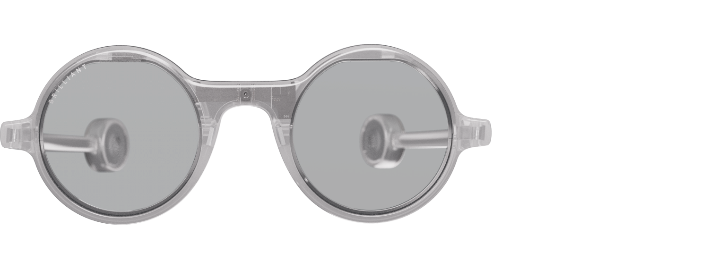
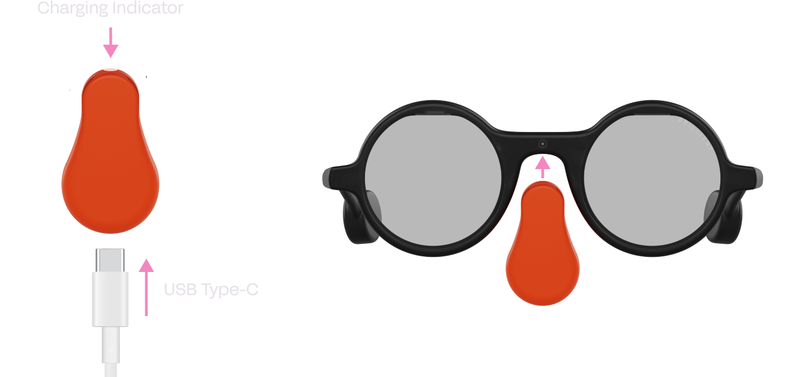
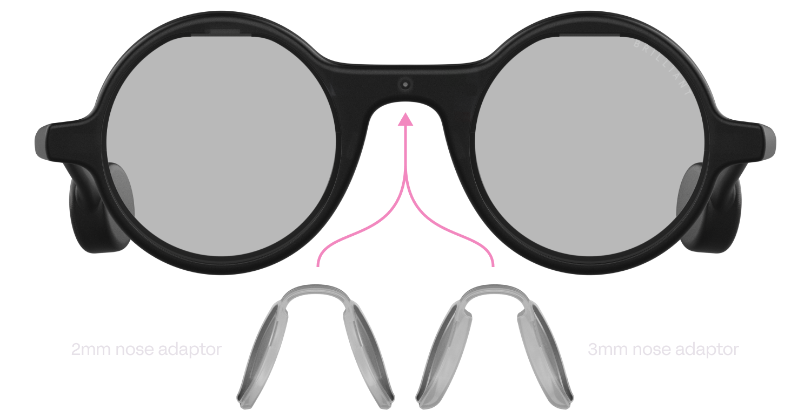
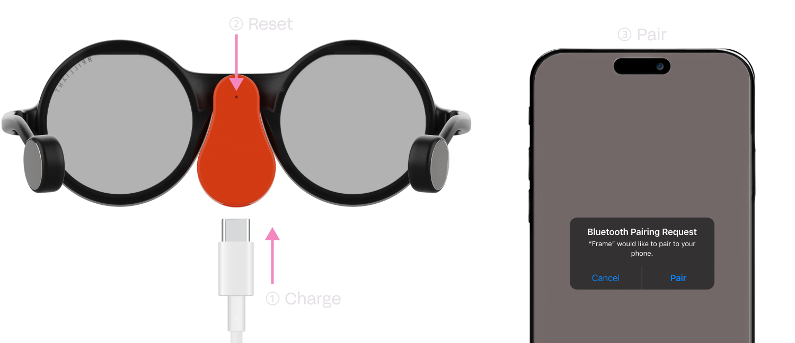

# Getting started with Frame

Whether you're using Frame with Noa, or making your own apps, you'll find everything you need to know about your Frame hardware here.

## How do I charge my Frame?

Your Frame will automatically power off, and start charging whenever it is placed onto the charging cradle (aka Mister Power).

The charging cradle provides an extra helping of battery power for when you're on the go. To charge both Frame and the charging cradle, use any USB Type-C power supply.

The cradle and Frame when docked together will take around 2 hours to fully charge. The white LED on the cradle will turn off to indicate that charging is complete.

## How do I set the bridge height?

Choosing the correct nose bridge adaptor is key to seeing the full display area. You can choose between 3mm, 2mm or no nose bridge adaptor to set the correct level.

## How do I connect to my Frame for the first time?

Ensure your Frame is charged, and then with the charging cradle connected, use a sim card tool and hold the pairing button for 3 seconds. Then remove the dock, and from any Frame compatible app, such as Noa, press connect, and then tap pair.

## How do I update my Frame?

Whenever software updates are available for your Frame, you'll be notified in your Frame compatible apps. Ensure Frame is well charged before updating to prevent partial updates and having to start again. Be sure to keep the app open and within close range of your Frame during the entire update.

## Where can I download Noa?

Noa for Frame is the original companion app for Frame. Its source code is available in the [noa-flutter repository on Github](https://github.com/brilliantlabsAR/noa-flutter), where you can also download the [latest Android APK](https://github.com/brilliantlabsAR/noa-flutter/releases/latest).

{: .note }
> **Getting started with Halo?** Noa for Frame is not the app for Halo. Head over to the [Getting started with Halo](/halo/halo) page instead.

**Using Frame (not Halo)? Check out the Getting Started with Frame playlist [here](https://www.youtube.com/watch?v=olNhbZTx6Lw&list=PLfbaC5GRVJJgSPdN-KWndTld35tihu1Ic)**

## Developer?

Get started making your own apps today. Follow the links below to familiarize yourself with the Frame hardware and Lua API.